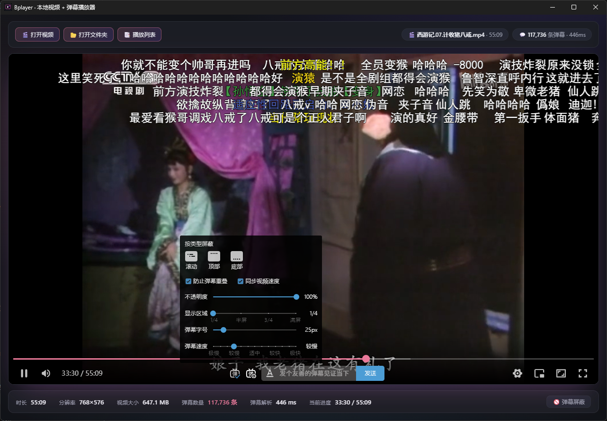

# danmuku-video-player

本地视频弹幕播放器（Bplayer 桌面版）：打开本机视频，自动加载同名弹幕文件一起播放。



## 功能

- 视频与同目录同名 `.xml` / `.json` 弹幕自动配对，兼容 B 站导出的弹幕格式
- 拖入文件夹即生成剧集播放列表，点击换集、播完自动下一集
- 弹幕参数可调（按类型屏蔽、防重叠、透明度、显示区域、字号、速度），屏蔽词表改完立即生效

## 运行要求

Windows 10 / 11，需要 WebView2 运行时。

## 构建

需要 Node.js 18+ 和 Rust 工具链。

```powershell
npm install
npm run build
```

安装包输出到 `src-tauri/target/release/bundle/nsis/`。

## 许可证

[MIT](LICENSE)
